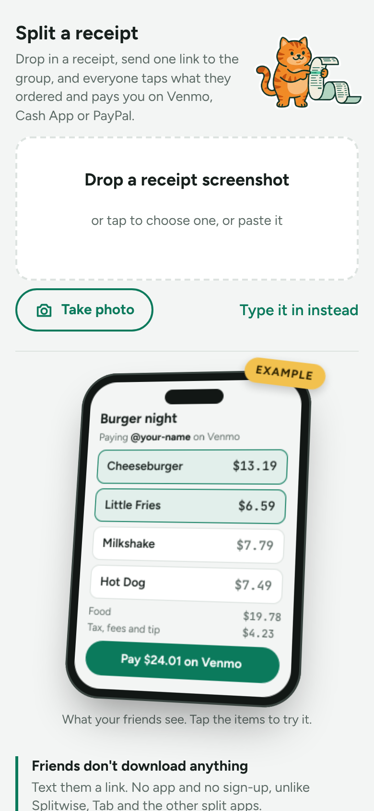
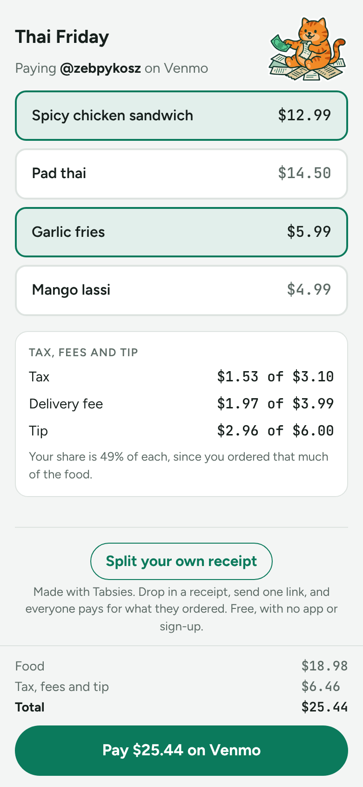

  

# Tabsies

Split a food order on Venmo, Cash App or PayPal from a receipt screenshot.

  
  

1. Open the site and drop in a receipt screenshot. The text is read in your browser, so nothing is uploaded.
2. Check the items and fees, add any of your Venmo, Cash App or PayPal usernames, and create a link.
3. Send the link to the group. Each person taps what they ordered and gets a pay button for each app you added, prefilled with their amount. Venmo also fills in a note with what they ordered; Cash App and PayPal links can't carry a note. Tax, fees and tip are split in proportion to food.

The order is stored in the link itself (`#o=…`), so there's no backend or database.

Deployed to Vercel on every push to `main`. `vercel.json` copies an allowlist of site files into `public/`, so a new top-level file or folder has to be added to its `buildCommand`.

## Install as an app

Tabsies is a PWA. On Android, open the site in Chrome and choose "Add to Home screen". Once installed, Tabsies appears in the share sheet, so you can share a receipt screenshot straight into it. On iPhone, use Safari's Share → "Add to Home Screen". Your payment usernames are saved on your device.
